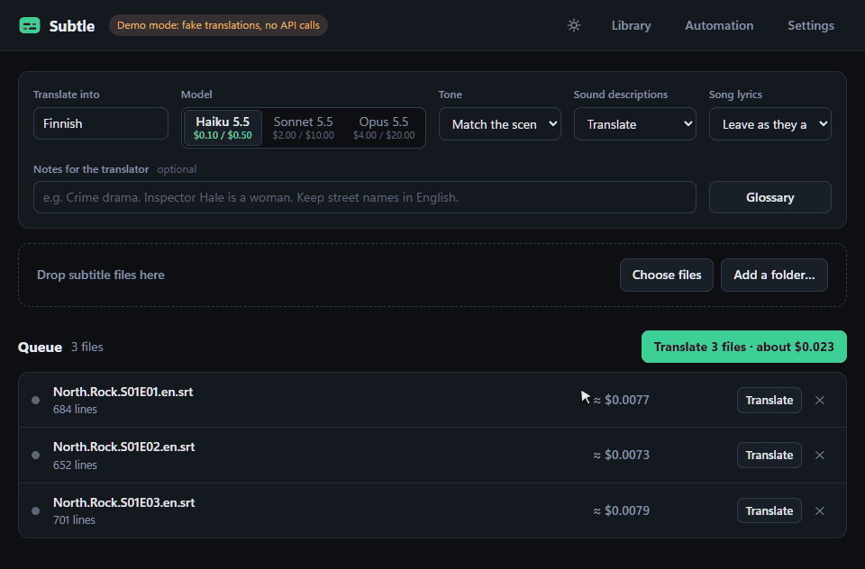
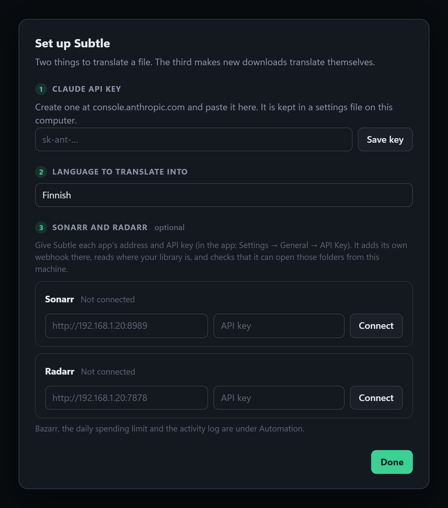
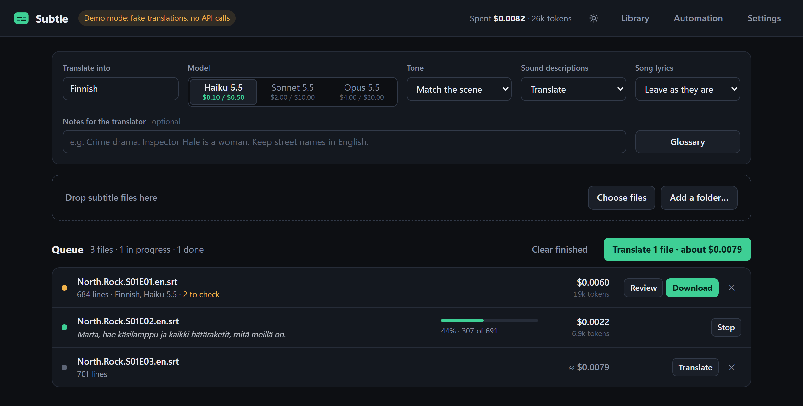
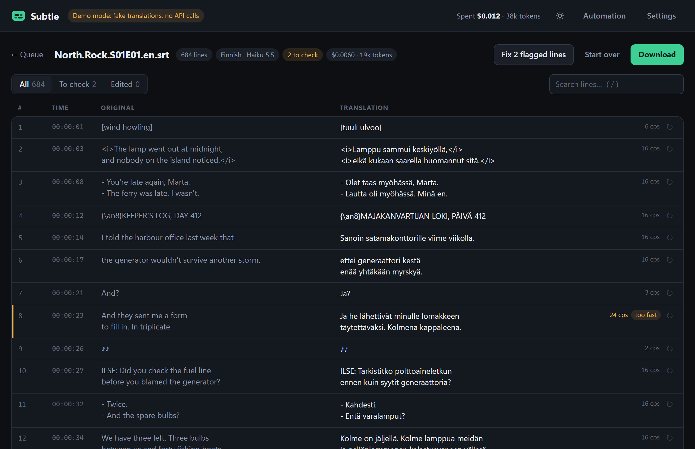

# Subtle

Translates subtitle files (`.srt`, `.vtt`, `.ass`/`.ssa`) and plain `.txt` with Claude, built
to send as few tokens as it can: an estimated cent or so an episode on the default model.
Local web UI plus a command line.



*The pictures on this page are from demo mode: no API calls, and quicker than a real run. The
Finnish in them was prepared for the demo file; it is not output from a live translation.*

## Status

Early. Two films have been translated and one proofread against the live API, all English to
Finnish; everything else has only met the built-in fake model. What has and has not been tried:

| Part | State |
|---|---|
| Translating, the web UI | Covered by the tests and tried by hand. Two live runs on Haiku 5.5: a 936-line film for $0.014, and a fast-talking 1,878-line one for about 5 cents. A native speaker called the first good enough to watch, with some lines that read oddly. Other languages and models are untried. |
| Proofreading | Covered by the tests. One live run: Sonnet 5.5 reading the 1,878-line translation changed 44 lines for about 21 cents. Whether those were the right 44 has not been judged yet. |
| Repair | Covered by the tests. Not looked at in the live runs. |
| Subtitles inside video files | Tried with real ffmpeg on MKV and MP4 files. Picture-based tracks only with stand-in data. |
| Sonarr, Radarr, Bazarr | Written against their source and tested against stand-ins. Not tried with real instances. |
| Dockerfile | Never built. |

Start with one file and a low spending cap, and read the result before trusting it with a library.

## Run it

```bash
pip install anthropic
```

```bash
python -m subtle
```

That opens the UI at http://localhost:8756. The first time, a setup screen asks for an
Anthropic API key (or set `ANTHROPIC_API_KEY`) and a language, and offers to connect Sonarr
and Radarr. After that: drop files, press **Translate**.



To try the UI with fake translations and no key:

```bash
python -m subtle --mock --data .subtle-demo
```

`pip install -e .` adds a `subtle` command so you can drop the `python -m`.

## Command line

```bash
python -m subtle translate "D:\Media\Some Show\Season 1" --to fi
```

```bash
python -m subtle estimate episode.en.srt --to fi --model sonnet
```

Folders are searched recursively. Output lands next to each source as `name.<lang>.srt`
(`Show.S01E01.en.srt` becomes `Show.S01E01.fi.srt`), which is what Jellyfin and Plex pick up.
Existing translations are skipped unless you pass `--force`. `--help` lists the rest
(`--model`, `--sdh strip`, `--register`, `--notes`, `--bilingual`, `--budget`, `--out`,
`--proofread`, `--proofread-model sonnet`).

## Why it is cheap

| | |
|---|---|
| Wire format | `N\|text` in, `N\|translation` out. About two tokens of framing per line. No JSON, no timestamps, no echoed source. |
| Prompt | Roughly 300 tokens, sent once per ~120 lines. |
| Free work | Tags, positions, line breaks, music symbols, number-only lines and (optionally) sound descriptions are handled locally and never sent. |
| Model | Haiku 5.5 with reasoning switched off. Sonnet and Opus are one click away and run at low effort. |
| Checking | Done locally: every line number must come back with words in it, plus reading speed, line length, leftover English and tag checks. A second model pass exists but is optional (see Proofreading). |
| Repair | Only the lines that came back wrong are re-sent, with a neighbour either side. Requests are capped per chunk. |
| Cache | A finished chunk is never paid for twice: stop, resume, re-run or change one glossary entry and only the affected chunks are sent. |
| Spend cap | Each file stops at four times its estimate (or a dollar figure you set). |

Estimates for a 45-minute episode of about 700 lines, from the built-in estimator. Both live
translations (see Status) cost more than estimated: a fifth more for one film, and between one
and a half times and double for the other:

| Model | Per episode |
|---|---|
| Haiku 5.5 | about $0.01 |
| Sonnet 5.5 | about $0.20 |
| Opus 5.5 | about $0.40 |

The UI shows the estimate before you start and the real token counts and cost as it runs.

## Proofreading

The translator works a scene at a time, so it cannot notice that it called the same thing by two
different words an hour apart, and it never gets a second look at its own slips. **Proofread** on
a file's review screen sends the whole translation, original beside it, in one request, and gets
back only the lines that should change: an idiom translated word for word, a wrong inflection, a
term that changed half way through.

- You choose which model reads, and see the estimate before it starts. Reading costs less than
  translating with the same model, because nearly all of it is input. A stronger reader still
  costs more than a cheap translator: in the one live run, Sonnet reading the 1,878-line film
  cost about 21 cents (the estimate said 22), four times what Haiku had cost to translate it.
- A model reading its own work catches less than a stronger one. If a translation reads oddly
  throughout, translating with the stronger model is the surer fix. See the table below.
- Changed lines are listed under their own tab with the earlier wording shown beneath, and one
  click puts a line back, or all of them.
- Lines you edited yourself are never changed. A correction that loses the words, the tags or
  the line limit is thrown away.
- Settings can run it after every translation, which also covers automatic ones.

Which model translates and which one reads, for the 936-line film in Status. The costs in the
table are estimates, and the order of quality is what to expect, not something measured yet:

| Translated by | Read by | Cost | |
|---|---|---|---|
| Haiku | nobody | $0.01 | The default. Good enough to watch, with some lines that read oddly. |
| Haiku | Haiku | $0.02 | Catches slips and a term translated two ways. Tends to miss what it misunderstood the first time. |
| Haiku | Sonnet | $0.11 | The recommended step up: the stronger reader also catches misread idioms. |
| Sonnet | nobody | $0.27 | Better phrasing on every line, not only the corrected ones. |
| Sonnet | Sonnet | $0.37 | The same, made consistent across the whole film. |
| Sonnet | Haiku | $0.28 | Not recommended. A reader corrects what it can tell is wrong, and a weaker one can "correct" lines the stronger translator got right. |

Measured once, on the 1,878-line film: Haiku translating plus Sonnet reading came to $0.26 in
all. Sonnet translating that film is estimated at $0.66, and translation estimates have run low
so far.

The review screen marks the recommended reader for each file and warns about a weaker one.

## What the UI does



- Queue with a cost estimate per file, live progress and the line currently being translated.
- **Add a folder** scans a path on disk and writes each translation beside its source.
- Review screen: original and translation side by side, filling in as the model streams.
  Click a line to edit it. `Ctrl+Enter` moves to the next line, `Esc` reverts, `/` searches.
- Lines that fail a check are flagged. **Fix flagged lines** re-sends only those: untranslated
  ones are redone, lines too long for their time on screen are shortened.
- `↻` on any line translates it again, optionally with an instruction ("more casual").
- Glossary for names and terms. Only entries that occur in a request are sent with it.
- Tone, sound-description stripping, lyric handling and a free-text note for the translator.



## Layout

```
subtle/
  formats.py    read/write srt, vtt, ass, txt (timing never leaves this file)
  prep.py       cue -> lines for the model and back; SDH stripping, tags, speakers
  wire.py       the N|text format and its tolerant parser
  chunker.py    split at scene changes
  prompt.py     the whole prompt
  engine.py     translate, repair, budget cap, retranslate, proofread
  qa.py         local quality flags
  wrap.py       line breaking
  media.py      subtitles for a video: sidecar file, or a track pulled out with ffmpeg
  arr.py        Sonarr/Radarr API (connect, add the webhook) and webhook bodies, path mapping, Bazarr API
  providers.py  Claude (and the offline mock used by tests and --mock)
  cache.py      sqlite cache of finished chunks
  server.py     local web server (standard library only)
  web/          the UI (no build step)
tests/          python -m unittest discover -s tests
docs/           the pictures on this page
```

Settings, cache and queue live in `~/.subtle` (override with `--data` or `SUBTLE_HOME`).

## Video files

With ffmpeg installed (`winget install ffmpeg` on Windows; it is found there even by a terminal
opened before the install), a video can stand in for a subtitle file:

```bash
python -m subtle translate "D:\Media\Some Show\Season 1\Some.Show.S01E01.mkv" --to fi
```

A subtitle file next to the video (`name.en.srt`, `name.srt`) is used if there is one.
Otherwise the English text track inside the file is pulled out: the full-dialogue track is
preferred over forced and hearing-impaired ones. The translation is saved beside the video as
`name.<lang>.srt`. Picture-based tracks (PGS, VobSub) cannot be translated and are reported as
such. **Add a folder** in the UI and folder arguments on the command line pick videos up too.

## Automation: Sonarr, Radarr, Bazarr

In the setup screen (first run, or **Automation → Connect Sonarr or Radarr**), give each app's
address and API key and press **Connect**. Subtle then:

- adds its own webhook in the app, with only the import and upgrade triggers on. The app tests
  the address before saving it, so a webhook that is there is one that reaches Subtle;
- reads the app's library folders and checks it can open them from this machine. A folder that
  sits somewhere else here is asked for once, checked against the show or movie folders the app
  lists, and saved as a path mapping;
- says plainly what is wrong if any of that fails. **Disconnect** removes the webhook again.

If Sonarr or Radarr cannot reach the address Subtle worked out for itself, the screen shows a
field for the right one. To add the webhook by hand instead, **Automation** has the two URLs
(each carries a secret): Settings → Connect → Webhook in each app, import and upgrade triggers on.

For each import that is reported:

1. Skip it if subtitles in the target language already exist, as a file or as a track.
2. If Bazarr is connected, ask it to search first. If it finds subtitles, nothing is translated.
   Optionally give it more time (`Wait before translating`).
3. Otherwise translate the source subtitles, save `name.<lang>.srt` beside the video and tell
   Bazarr to rescan.

Everything it does is listed under Recent activity with what it cost. Automatic translations
stop for the day at a dollar limit you set (default $1).

Subtle has to see the same files Sonarr and Radarr report, and they have to reach it:

```bash
python -m subtle serve --host 0.0.0.0 --password "something" --no-open
```

If the library sits under a different path here than there (`/tv` in a container, `D:\Media\TV`
on this machine), connecting asks for it; mappings can also be edited in the Automation screen.
In Docker, mount the library at the same paths as Sonarr/Radarr and no mapping is needed:

```yaml
services:
  subtle:
    build: .
    ports: ["8756:8756"]
    environment:
      ANTHROPIC_API_KEY: "sk-ant-..."
      SUBTLE_PASSWORD: "something"
    volumes:
      - ./data:/data
      - /srv/media/tv:/tv
      - /srv/media/movies:/movies
    restart: unless-stopped
```

A translation waiting on Bazarr or in progress is not picked up again if Subtle is restarted
mid-way; the next import or **Add a folder** will catch it.

## Not included

- Speech-to-text. A video with no text subtitles in the source language cannot be translated.
- Other model providers. `providers.py` is the seam: anything with a `complete()` method works.

## Security

Subtle is meant for your own machine or home network, not the open internet.

- It listens on this machine only unless you pass `--host`. With `--host 0.0.0.0` and no
  `--password`, anyone who can reach the port can use it, list the subtitle and video files
  under any folder it can read, and spend your API credit.
- The password is HTTP Basic over plain HTTP. Beyond a network you trust, put Subtle behind a
  reverse proxy that adds HTTPS.
- The Claude, Sonarr, Radarr and Bazarr API keys are stored unencrypted in `config.json` in the
  data folder (`~/.subtle` by default). Protect that folder as you would the keys.
- Webhook URLs carry a secret in the query string, so it is visible in Sonarr's and Radarr's
  settings and may appear in their logs.
- The server reads subtitle and video files from the paths it is given and writes
  `name.<lang>.srt` next to them. Run it as a user that can reach your media and little else.

## Licence

MIT. See [LICENSE](LICENSE).
