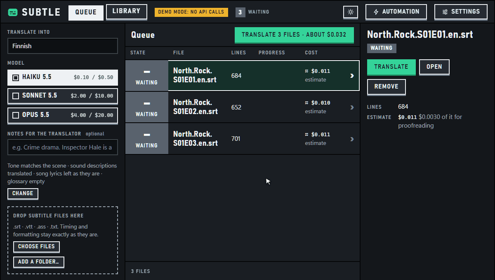
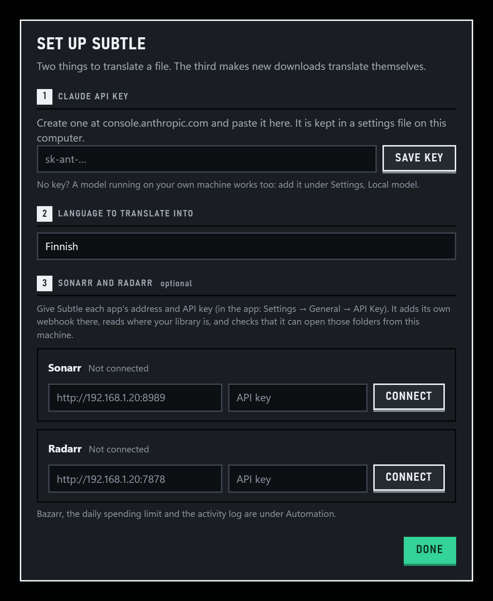
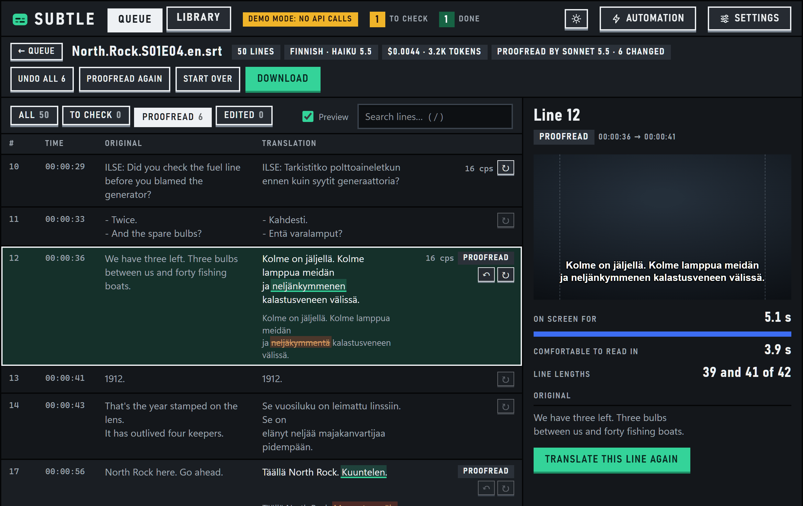
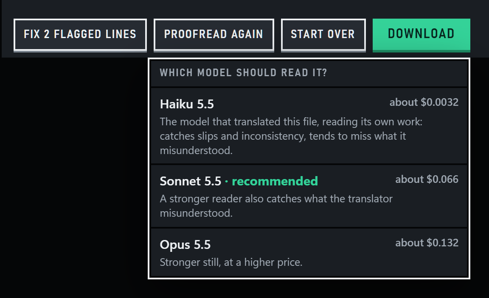
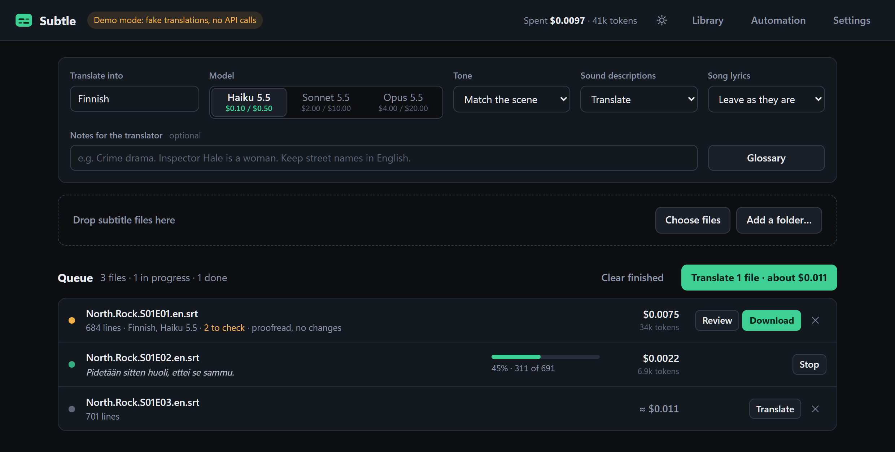
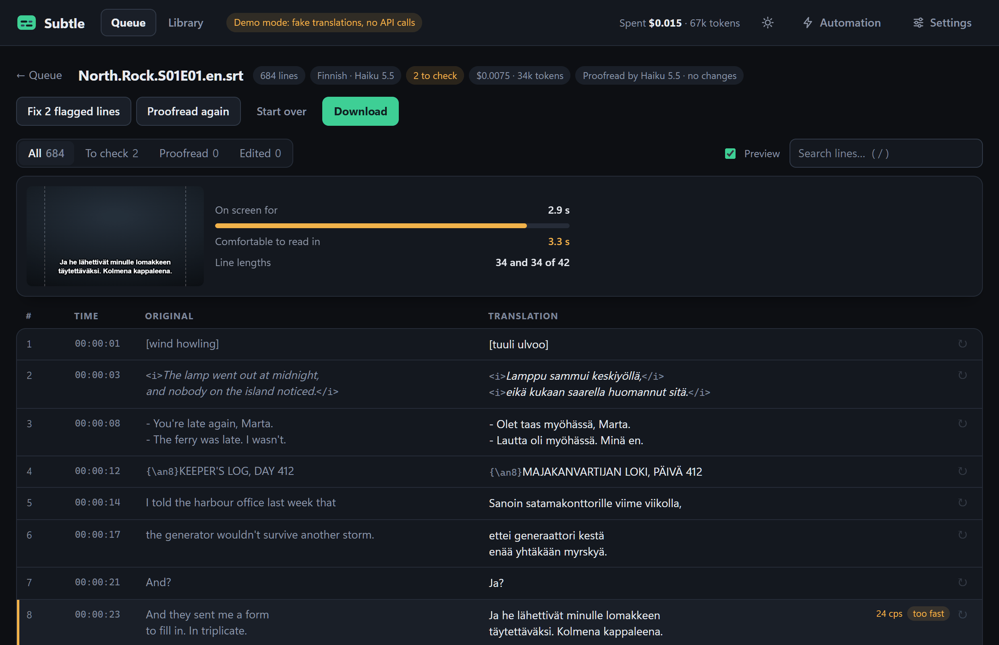
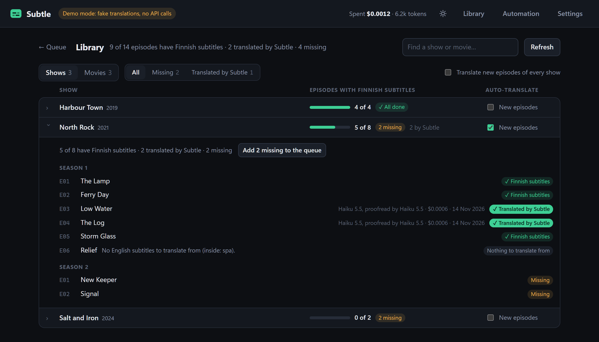

# Subtle

Translates subtitle files (`.srt`, `.vtt`, `.ass`/`.ssa`) and plain `.txt` with Claude, built
to send as few tokens as it can: an estimated cent or so an episode on the default model,
proofreading included. It can also use a model running on your own machine. Local web UI plus
a command line.



*The pictures on this page are from demo mode: no API calls, and quicker than a real run. The
Finnish in them, the proofreading slips and corrections included, was written for the demo; it
is not output from a live translation. The shows and movies are invented.*

## Status

Early. Two films have been translated and one proofread against the live API, all English to
Finnish; everything else has only met the built-in fake model. What has and has not been tried:

| Part | State |
|---|---|
| Translating, the web UI | Covered by the tests and tried by hand. Two live runs on Haiku 5.5: a 936-line film for $0.014, and a fast-talking 1,878-line one for about 5 cents. A native speaker called the first good enough to watch, with some lines that read oddly. Other languages and models are untried. |
| The page layout, line preview, word-level proofreading marks, tab title, notifications, phone layout | The page itself has no tests. These were driven in a headless Chrome on the demo show, at desktop and phone width. Nobody has used them on a real file yet, a real notification has never been seen, and Chrome is the only browser tried. |
| Proofreading | Covered by the tests. One live run: Sonnet 5.5 reading the 1,878-line translation changed 44 lines for about 21 cents. Whether those were the right 44 has not been judged yet. The default, a model reading its own translation, has not had a live run. |
| Repair | Covered by the tests. Not looked at in the live runs. |
| Subtitles inside video files | Tried with real ffmpeg on MKV and MP4 files. Picture-based tracks only with stand-in data. |
| Sonarr, Radarr, the Library page | Written against their source and tested against stand-ins. One user has since run them against a real Sonarr and Radarr and reports that it works; which parts that covered is not recorded. |
| Bazarr | Written against its source and tested against a stand-in. Not tried with a real instance. |
| Local models | Written against Ollama's documentation and the OpenAI chat format, and tested against a stand-in server. Never run against a real Ollama, LM Studio or llama.cpp, and nobody has looked at what a local model makes of a subtitle file. |
| The report (`subtle report`) | Covered by tests on a made-up data folder filled with keys, addresses and show names, none of which reach the report. Never run on a real install. |
| Dockerfile | Never built. |

Start with one file and a low spending cap, and read the result before trusting it with a library.

## Run it

```bash
pip install anthropic
```

```bash
python -m subtle
```

That opens the UI at http://localhost:8756. The first time, a setup screen asks for an
Anthropic API key (or set `ANTHROPIC_API_KEY`) and a language, and offers to connect Sonarr
and Radarr. After that: drop files, press **Translate**. Without a key, a model on your own
machine can do the work instead: see Local models.



To try the UI with fake translations and no key:

```bash
python -m subtle --mock --data .subtle-demo
```

`pip install -e .` adds a `subtle` command so you can drop the `python -m`.

## Command line

```bash
python -m subtle translate "D:\Media\Some Show\Season 1" --to fi
```

```bash
python -m subtle estimate episode.en.srt --to fi --model sonnet
```

Folders are searched recursively. Output lands next to each source as `name.<lang>.srt`
(`Show.S01E01.en.srt` becomes `Show.S01E01.fi.srt`), which is what Jellyfin and Plex pick up.
Existing translations are skipped unless you pass `--force`. `--help` lists the rest
(`--model`, `--sdh strip`, `--register`, `--notes`, `--bilingual`, `--budget`, `--out`,
`--no-proofread`, `--proofread-model sonnet`). `--model local` uses the local model from the
settings.

### Telling whoever works on Subtle how it went

```bash
python -m subtle report
```

This writes `subtle-report.txt` in the current folder, so that you can say how Subtle has been
doing without sending your library. It holds, for each file Subtle saved, the model, the cost,
the line count, the flags and what proofreading changed; for what is in the queue, the estimate
against what was spent, the token counts and the flags by kind; and what the automation log
says was skipped or failed, and why.

- File and show names become `file 1`, `file 2`. Keys, addresses, folders, the note for the
  translator and the glossary are left out, and no subtitle text is included.
- `--lines 5` adds up to five quoted lines for each kind of flag and five proofreading changes,
  original beside translation. That is subtitle text, so it is off unless you ask.
- Error messages are passed on with names and addresses replaced. A name with spaces in it
  that Subtle has no record of can survive in part, so read the file through before sending it.
- Nothing is sent anywhere, and Subtle's own files are only read. `--data` points it at another
  data folder, and `-o -` prints the report instead of writing it.

## Why it is cheap

| | |
|---|---|
| Wire format | `N\|text` in, `N\|translation` out. About two tokens of framing per line. No JSON, no timestamps, no echoed source. |
| Prompt | Roughly 300 tokens, sent once per ~120 lines. |
| Free work | Tags, positions, line breaks, music symbols, number-only lines and (optionally) sound descriptions are handled locally and never sent. |
| Model | Haiku 5.5 with reasoning switched off. Sonnet and Opus are one click away and run at low effort. |
| Checking | Done locally: every line number must come back with words in it, plus reading speed, line length, leftover English and tag checks. One more request then reads the finished file through and sends back only corrections (see Proofreading). |
| Repair | Only the lines that came back wrong are re-sent, with a neighbour either side. Requests are capped per chunk. |
| Cache | A finished chunk is never paid for twice: stop, resume, re-run or change one glossary entry and only the affected chunks are sent. |
| Spend cap | Each file stops at four times its estimate (or a dollar figure you set). |

Estimates for a 45-minute episode of about 700 lines, from the built-in estimator. Both live
translations (see Status) cost more than estimated: a fifth more for one film, and between one
and a half times and double for the other:

| Model | Translating | With the same model proofreading (the default) |
|---|---|---|
| Haiku 5.5 | about $0.008 | about $0.011 |
| Sonnet 5.5 | about $0.18 | about $0.24 |
| Opus 5.5 | about $0.36 | about $0.48 |

The UI shows the estimate before you start, proofreading included, and the real token counts
and cost as it runs.

## Proofreading

The translator works a scene at a time, so it cannot notice that it called the same thing by two
different words an hour apart, and it never gets a second look at its own slips. So every
finished translation is read once more: the whole of it goes out in one request, original
beside it, and only the lines that should change come back: an idiom translated word for word,
a wrong inflection, a term that changed half way through.

This runs after every translation, automatic ones included, with the model that translated the
file. That adds about 40% to the estimate, and the estimates in the queue include it. Settings
has the switch to turn it off (`--no-proofread` on the command line) and the choice of another
model to read. **Proofread** on a file's review screen runs it again, with any model.



- Reading costs less than translating with the same model, because nearly all of it is input.
  A stronger reader still costs more than a cheap translator: in the one live run, Sonnet
  reading the 1,878-line film cost about 21 cents (the estimate said 22), four times what Haiku
  had cost to translate it. The review screen's menu shows an estimate for each model first.
- A model reading its own work catches less than a stronger one. If a translation reads oddly
  throughout, translating with the stronger model is the surer fix. See the table below.
- Changed lines are listed under their own tab with the earlier wording beneath. Only the words
  that changed are marked, in both; a line rewritten outright has its earlier wording struck
  through whole. One click puts a line back, or all of them.
- Lines you edited yourself are never changed. A correction that loses the words, the tags or
  the line limit is thrown away.
- If the reading fails, the translation is kept and saved as it was.

Which model translates and which one reads, for the 936-line film in Status. The costs in the
table are estimates, and the order of quality is what to expect, not something measured yet:

| Translated by | Read by | Cost | |
|---|---|---|---|
| Haiku | nobody | $0.01 | Proofreading switched off. Good enough to watch, with some lines that read oddly. |
| Haiku | Haiku | $0.02 | The default. Catches slips and a term translated two ways. Tends to miss what it misunderstood the first time. |
| Haiku | Sonnet | $0.11 | The recommended step up: the stronger reader also catches misread idioms. |
| Sonnet | nobody | $0.27 | Better phrasing on every line, not only the corrected ones. |
| Sonnet | Sonnet | $0.37 | The same, made consistent across the whole film. |
| Sonnet | Haiku | $0.28 | Not recommended. A reader corrects what it can tell is wrong, and a weaker one can "correct" lines the stronger translator got right. |

Measured once, on the 1,878-line film: Haiku translating plus Sonnet reading came to $0.26 in
all. Sonnet translating that film is estimated at $0.66, and translation estimates have run low
so far.

The review screen marks the recommended reader for each file and warns about a weaker one.



## Local models

A model on your own hardware can translate, proofread, or both, with no API key and nothing to
pay per file. **Settings → Local model** takes the server's address; **Look for models** lists
what it has. The one you pick then sits next to Claude's models on the main page.

- **Ollama** (`http://localhost:11434`) is spoken to through its own API. Each request says how
  much context it needs and asks for no reasoning.
- **Anything else that speaks the OpenAI chat API**: LM Studio (`http://localhost:1234`),
  llama.cpp's server, vLLM. There the context is whatever the model was loaded with, so set
  **Context size** in Settings to match it.
- Requests are sized to fit the context: about 60 lines at a time in 4,096 tokens, the full 120
  from about 7,000 up. A larger context means fewer requests and more of the scene in view.
- Proofreading with a local model reads the script a stretch at a time, for the same reason,
  so it cannot compare lines that are far apart. A Claude model can read what a local one
  translated, and the other way round.
- One request goes out at a time, and **Stop** works while the model is still thinking.
- With only a local model, `pip install anthropic` can be skipped: Subtle itself needs nothing
  beyond Python.

None of this has met a real server yet (see Status), and how well a given model translates into
a given language is a separate question from whether the plumbing works. Expect a small model
to be slower, to skip or merge more lines (those are re-asked and, failing that, flagged), and
to read less naturally than Claude. Try one episode and read it before queueing a season.

## What the UI does



- Queue with a cost estimate per file, live progress and the line currently being translated.
  Each file's state is a coloured block: waiting, translating, done, or how many lines to check.
- Select a file and a pane beside the queue shows what it cost, what was done to it and which
  lines to check. The arrow at the end of its row, or a double-click, opens it.
- Anything you can press is drawn as a key, an outline with an edge under it. Coloured blocks
  and tags only tell you a state.
- **Add a folder** scans a path on disk and writes each translation beside its source.
- The browser tab's title says how far along the queue is, and that it has finished until you
  look. **Settings → Notifications** adds a browser notification for that; browsers only allow
  those on a page opened as localhost or over HTTPS.
- Review screen: original and translation side by side, filling in as the model streams.
  Click a line to edit it. `Ctrl+Enter` moves to the next line, `Esc` reverts, `/` searches.
  Formatting tags stay in the text, dimmed, and italics are drawn as italics.
- The line you select is drawn the way a viewer sees it in a pane beside the list (above it
  on a narrow window), with how long it stays on screen set against how long it takes to read
  at the speed limit. The dashed lines mark the longest line
  allowed. The **Preview** box switches this off.
- Lines that fail a check are flagged. **Fix flagged lines** re-sends only those: untranslated
  ones are redone, lines too long for their time on screen are shortened. With a filter or a
  search on, selecting a line shows the two before and after it as well.
- `↻` on any line translates it again, optionally with an instruction ("more casual").
- **Library** lists the shows and movies Sonarr and Radarr know, with what each video has by
  way of subtitles (see Automation).
- A free-text note for the translator. Tone, sound-description stripping, lyric handling and
  the glossary sit behind **Change**, under a line that says what they are set to.
- Glossary for names and terms. Only entries that occur in a request are sent with it.



## Layout

```
subtle/
  formats.py    read/write srt, vtt, ass, txt (timing never leaves this file)
  prep.py       cue -> lines for the model and back; SDH stripping, tags, speakers
  wire.py       the N|text format and its tolerant parser
  chunker.py    split at scene changes
  prompt.py     the whole prompt
  engine.py     translate, repair, budget cap, retranslate, proofread
  qa.py         local quality flags
  wrap.py       line breaking
  media.py      subtitles for a video: sidecar file, or a track pulled out with ffmpeg
  arr.py        Sonarr/Radarr API (connect, add the webhook, list the library), path mapping, Bazarr API
  library.py    what each video has, and the record of the subtitle files Subtle wrote
  providers.py  Claude, local model servers (and the offline mock used by tests and --mock)
  cache.py      sqlite cache of finished chunks
  report.py     numbers on how it has been doing here, with every name left out
  server.py     local web server (standard library only)
  web/          the UI (no build step)
tests/          python -m unittest discover -s tests   (offline: stand-ins for every outside service)
docs/           the pictures on this page
```

Settings, cache and queue live in `~/.subtle` (override with `--data` or `SUBTLE_HOME`).

## Video files

With ffmpeg installed (`winget install ffmpeg` on Windows; it is found there even by a terminal
opened before the install), a video can stand in for a subtitle file:

```bash
python -m subtle translate "D:\Media\Some Show\Season 1\Some.Show.S01E01.mkv" --to fi
```

A subtitle file next to the video (`name.en.srt`, `name.srt`) is used if there is one.
Otherwise the English text track inside the file is pulled out: the full-dialogue track is
preferred over forced and hearing-impaired ones. The translation is saved beside the video as
`name.<lang>.srt`. Picture-based tracks (PGS, VobSub) cannot be translated and are reported as
such. **Add a folder** in the UI and folder arguments on the command line pick videos up too.

## Automation: Sonarr, Radarr, Bazarr

In the setup screen (first run, or **Automation → Connect Sonarr or Radarr**), give each app's
address and API key and press **Connect**. Subtle then:

- adds its own webhook in the app, with only the import and upgrade triggers on. The app tests
  the address before saving it, so a webhook that is there is one that reaches Subtle;
- reads the app's library folders and checks it can open them from this machine. A folder that
  sits somewhere else here is asked for once, checked against the show or movie folders the app
  lists, and saved as a path mapping;
- says plainly what is wrong if any of that fails. **Disconnect** removes the webhook again.

If Sonarr or Radarr cannot reach the address Subtle worked out for itself, the screen shows a
field for the right one. To add the webhook by hand instead, **Automation** has the two URLs
(each carries a secret): Settings → Connect → Webhook in each app, import and upgrade triggers on.

### The Library page

Once Sonarr or Radarr is connected, **Library** lists their shows and movies. Each show says
how many of its episodes have subtitles in your language and how many of those Subtle
translated; the counts fill in a few shows at a time after the page opens. Select a show to see
each episode beside the list: it has subtitles in your language, it was translated by Subtle (with the model,
the cost and the date), it is in the queue, it is missing them, or there is nothing to
translate from.



- **Missing** and **Translated by Subtle** above the list narrow it to the shows or movies
  that have any of either.
- **Add missing to the queue** puts those episodes or movies in the queue with an estimate
  each. Nothing is spent until you press Translate there. Each translation is saved beside its
  video, and the page follows along as they finish.
- **New episodes** on a show turns on automatic translation for that show. There is one switch
  for every show and one for new movies. All of them start off.
- What a video has is read from its folder every time, so the page stays right when files are
  added, replaced or removed outside Subtle. The one thing Subtle keeps is a record of the
  subtitle files it wrote (model, cost, date), which is how it tells its own work from real
  subtitles. A file that something else has since replaced no longer counts as Subtle's.
- The languages listed inside a video come from Sonarr's and Radarr's own scan, which cannot
  tell text subtitles from picture ones. An episode shown as missing can still turn out to have
  nothing usable; adding it to the queue says so.

### What happens to an import

Connecting does not translate anything by itself. An import is only acted on if its show is
switched on in the Library (or every show is, or new movies are). Then:

1. Skip it if subtitles in the target language already exist, as a file or as a track.
2. If Bazarr is connected, ask it to search first. If it finds subtitles, nothing is translated.
   Optionally give it more time (`Wait before translating`).
3. Otherwise translate the source subtitles, save `name.<lang>.srt` beside the video and tell
   Bazarr to rescan.

Everything it does is listed under Recent activity with what it cost. Automatic translations
stop for the day at a dollar limit you set (default $1).

Subtle has to see the same files Sonarr and Radarr report, and they have to reach it:

```bash
python -m subtle serve --host 0.0.0.0 --password "something" --no-open
```

If the library sits under a different path here than there (`/tv` in a container, `D:\Media\TV`
on this machine), connecting asks for it; mappings can also be edited in the Automation screen.
In Docker, mount the library at the same paths as Sonarr/Radarr and no mapping is needed:

```yaml
services:
  subtle:
    build: .
    ports: ["8756:8756"]
    environment:
      ANTHROPIC_API_KEY: "sk-ant-..."
      SUBTLE_PASSWORD: "something"
    volumes:
      - ./data:/data
      - /srv/media/tv:/tv
      - /srv/media/movies:/movies
    restart: unless-stopped
```

A translation waiting on Bazarr or in progress is not picked up again if Subtle is restarted
mid-way; the next import or **Add a folder** will catch it.

## Not included

- Speech-to-text. A video with no text subtitles in the source language cannot be translated.
- Other hosted model providers. The Local model setting speaks the OpenAI chat format, so one
  that offers it may work when entered there, but only servers on your own machine were in
  mind and none of either kind has been tried. `providers.py` is the seam: anything with a
  `complete()` method works.

## Security

Subtle is meant for your own machine or home network, not the open internet.

- It listens on this machine only unless you pass `--host`. With `--host 0.0.0.0` and no
  `--password`, anyone who can reach the port can use it, list the subtitle and video files
  under any folder it can read, and spend your API credit.
- The password is HTTP Basic over plain HTTP. Beyond a network you trust, put Subtle behind a
  reverse proxy that adds HTTPS.
- The Claude, Sonarr, Radarr and Bazarr API keys, and a local model server's if it has one, are
  stored unencrypted in `config.json` in the data folder (`~/.subtle` by default). Protect that
  folder as you would the keys.
- With a local model, the subtitle text goes to the server address you entered and nowhere
  else. Enter the address of a machine you trust.
- Webhook URLs carry a secret in the query string, so it is visible in Sonarr's and Radarr's
  settings and may appear in their logs.
- The server reads subtitle and video files from the paths it is given and writes
  `name.<lang>.srt` next to them. Run it as a user that can reach your media and little else.

## Licence

MIT. See [LICENSE](LICENSE).
